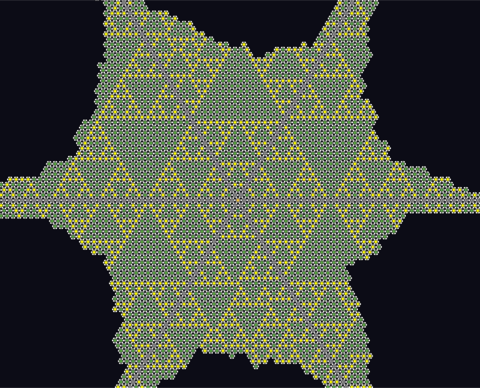
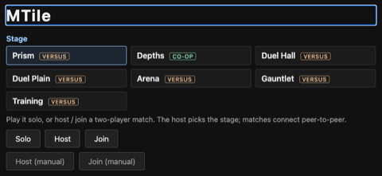
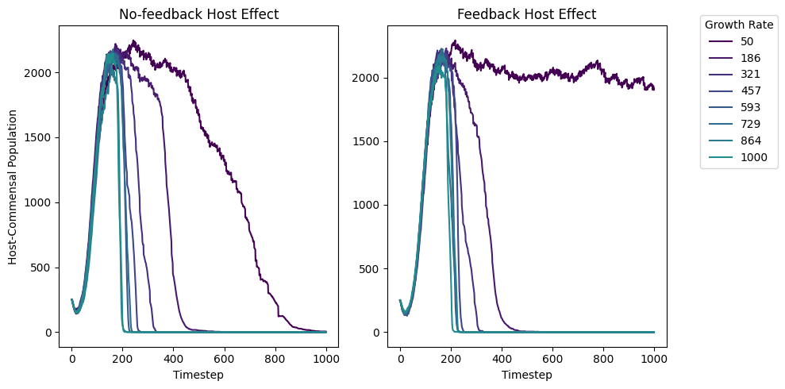

<h1 class="jb-pagetitle">Projects</h1>

<table class="jb-rows"><tbody>

<tr>
  <td style="padding:16px;width:20%;vertical-align:middle"></td>
  <td style="padding:8px;width:80%;vertical-align:middle">
    <a href="/docs/index.html">kMC Crystal Simulator</a>
     
    <em>Rust, WebAssembly</em>, 2026
     
    <a href="/docs/index.html">demo</a> / <a href="/docs/editor.html">config editor</a> / <a href="https://github.com/amdson/crystal_sim">code</a> / <a href="/blog/crystals/">post</a>
    
A kinetic Monte Carlo simulator for 2D crystal growth, written in Rust and compiled to WebAssembly. It can grow almost any design that can be specified in terms of local particle interactions, including non-periodic and off-lattice crystals, and crystals implementing programmatic rules such as an infinite Serpinski triangle. 

  </td>
</tr>

<tr>
  <td style="padding:8px 16px;width:100%;vertical-align:middle" colspan="2">
    <a href="https://github.com/amdson/mutant_cache">Sparse variant cache</a>
     
    <em>Python, PyTorch</em>, 2026
     
    <a href="https://github.com/amdson/mutant_cache">code</a>
    
Train protein variant-effect models by reusing reference states and recomputing only the mutated positions. A bidirectional sparse variant cache for ESM Cambrian, with stability models evaluated directly against the Mutate Everything and ArcStability benchmarks.

  </td>
</tr>

<tr>
  <td style="padding:16px;width:20%;vertical-align:middle"></td>
  <td style="padding:8px;width:80%;vertical-align:middle">
    <a href="/mtile/">MTile</a>
     
    <em>C#, MonoGame, WebRTC</em>, 2026
     
    <a href="/mtile/">play</a> / <a href="https://github.com/amdson/MTile">code</a>
    
A 2D platformer in a voxel environment, with free, parkour-style movement. Deterministic 60 fps simulation with GGPO-style rollback netcode. Playable in the browser, solo against a bot or peer-to-peer over a direct WebRTC data channel.

  </td>
</tr>

<tr>
  <td style="padding:16px;width:20%;vertical-align:middle"></td>
  <td style="padding:8px;width:80%;vertical-align:middle">
    <a href="https://github.com/amdson/mb_abm">Gut biofilm agent-based model</a>
     
    <em>Python, Taichi</em>, 2023–2025
     
    <a href="https://github.com/amdson/mb_abm">code</a> / <a href="https://doi.org/10.1038/s41522-024-00572-y">npj Biofilms and Microbiomes</a> / <a href="https://doi.org/10.1128/msystems.01652-24">mSystems</a>
    
An agent-based model of biofilm growth in the gut mucosal layer. Bacteria are implemented as shoving particles, which may feed and grow based on metabolites implemented as reaction-diffusion fields. Host effects such as mucus secretion and antibacterials are implemented as simulated parameters. GPU-accelerated physics and reaction-diffusion dynamics in Taichi.

  </td>
</tr>

<tr>
  <td style="padding:8px 16px;width:100%;vertical-align:middle" colspan="2">
    <a href="https://github.com/amdson/go_interp">Function-conditioned protein language models</a>
     
    <em>Python, PyTorch</em>, 2024–2026
     
    <a href="https://github.com/amdson/go_interp">code</a>
    
Semi-supervised identification of functionally important residues using GO-term-conditioned masked language modeling. FuncCondESMC extends ESM Cambrian with a learned embedding for each GO term, added to the token embeddings so every attention layer is conditioned on the protein's annotated function. Evaluated on eight site-annotation datasets covering catalytic residues, binding sites, linear motifs, and InterPro domains.

  </td>
</tr>

<tr>
  <td style="padding:8px 16px;width:100%;vertical-align:middle" colspan="2">
    <a href="https://github.com/amdson/calibrated_response">Calibrated Response</a>
     
    <em>Python</em>, 2026
     
    <a href="https://github.com/amdson/calibrated_response">code</a>
    
A maximum entropy model for turning sets of approximate predictions into calibrated joint probability distributions. Answers from arbitrary sources become soft constraints on a maximum-entropy joint distribution fit by a flow or EBM based sampler, scalable to >1,000 variables. Calibration is evaluated against resolved Metaculus questions.

  </td>
</tr>

<tr>
  <td style="padding:8px 16px;width:100%;vertical-align:middle" colspan="2">
    <a href="https://gobench.org">GO Bench</a>
     
    <em>Python, Flask</em>, 2021–2022
     
    <a href="https://gobench.org">gobench.org</a> / <a href="https://github.com/amdson/go_bench">dataset package</a> / <a href="https://github.com/amdson/GO_pipeline">server</a> / <a href="https://doi.org/10.1093/bioinformatics/btad081">paper</a>
    
Shared hub for universal benchmarking of machine-learning protein function annotation. The go_bench package generates Gene Ontology training, validation, and test sets from SwissProt and GOA with fixed splits, and the Flask server behind gobench.org lets users upload model predictions to a public leaderboard.

  </td>
</tr>

<tr>
  <td style="padding:8px 16px;width:100%;vertical-align:middle" colspan="2">
    <a href="https://github.com/amdson/starp">STARP Primer</a>
     
    <em>Python, Flask, BLAST</em>, 2023
     
    <a href="https://github.com/amdson/starp">code</a> / <a href="https://github.com/amdson/starp_blast_interface">BLAST interface</a>
    
A web application for designing and validating STARP PCR primers for genotyping individual single nucleotide polymorphisms, built for the USDA. A Flask API and HTML/JavaScript frontend over the Nested Loop and STARP primer programs, with a BLAST backend to filter primers that bind at multiple sites and a Redis/Celery queue for computationally intensive requests.

  </td>
</tr>

</tbody></table>

<h2 class="jb-listhead">All repositories</h2>

Public repositories on [github.com/amdson](https://github.com/amdson), newest first. One sentence each.

- [mutant_cache](https://github.com/amdson/mutant_cache) (2026, Python). Trains protein variant-effect models by reusing reference-sequence states and recomputing only the mutated positions, built on ESM-2 and ESM Cambrian.
- [MTile](https://github.com/amdson/MTile) (2026, C#). A 2D platformer in C#/MonoGame where the terrain is the weapon, with a deterministic 60 fps simulation, GGPO-style rollback netcode, and a browser build at [amdson.github.io/mtile](/mtile/).
- [Hierwave](https://github.com/amdson/Hierwave) (2026, Python). Fixed-budget hierarchical sampling of tile worlds, with learned coarse levels and designed fine levels, so infinite worlds can be generated chunk by chunk.
- [circscale](https://github.com/amdson/circscale) (2026, Python). Random reversible brickwork circuits with varied-depth output taps, for sampling input/output pairs at scale and generating SAT instances, with notebooks on training small networks to learn them.
- [gallrna](https://github.com/amdson/gallrna) (2026). Dual RNA-seq pipeline for *Agrobacterium* galls on citrus hosts, run on Slurm from a Makefile.
- [scrl](https://github.com/amdson/scrl) (2026, Python). Prototype of reward-conditioned self-consistency on a fixed 12x12 maze in JAX, with deterministic random-walk rollouts and exact ground truth.
- [svar](https://github.com/amdson/svar) (2026, Python). Benchmarks plant genomic language models (PlantCAD, DNABERT-2, CARBON) on variant, methylation, and crop-phenotype prediction, with Slurm scripts for embedding genome windows.
- [variant_cache](https://github.com/amdson/variant_cache) (2026, Python). Notebooks for iterating over VCF files, remapping variants, and fitting SNP baseline models for the crop_embed package.
- [gg_qa](https://github.com/amdson/gg_qa) (2026, Python). A library for querying PDFs with page-level text extraction, vector search, and an LLM through PydanticAI and OpenRouter.
- [calibrated_response](https://github.com/amdson/calibrated_response) (2026, Python). A framework that combines multiple LLM-generated distributional predictions into one calibrated forecast using maximum entropy models, evaluated on resolved Metaculus questions.
- [crystal_sim](https://github.com/amdson/crystal_sim) (2026, Rust). A kinetic Monte Carlo 2D crystal growth simulator in Rust compiled to WebAssembly, with a browser config editor and runner at [/docs/](/docs/index.html).
- [gv_abm](https://github.com/amdson/gv_abm) (2025, Python). Agent-based model of gun violence with likelihood evaluation over parameter grids and Bayesian calibration, the code behind the PNAS Nexus paper.
- [rtcpvp](https://github.com/amdson/rtcpvp) (2025, JavaScript). A two-player browser game connected peer to peer over WebRTC, playable at [/rtcpvp](/rtcpvp).
- [go_interp](https://github.com/amdson/go_interp) (2024, Python). Function-conditioned protein language models: ESM Cambrian extended with learned Gene Ontology term embeddings to sharpen residue-level predictions at functional sites, evaluated on eight site-annotation datasets.
- [mb_abm](https://github.com/amdson/mb_abm) (2023, Python). Agent-based biofilm model of gut mucosal bacterial communities in Taichi, with particle shoving, reaction-diffusion fields, and host-invasion experiments.
- [starp](https://github.com/amdson/starp) (2023, Python). Flask web application providing a graphical interface for the Nested Loop and STARP primer design programs.
- [starp_blast_interface](https://github.com/amdson/starp_blast_interface) (2023, Python). Flask service that runs blastn against a local genome database to check STARP primers.
- [rec-display](https://github.com/amdson/rec-display) and [rec-server](https://github.com/amdson/rec-server) (2023, JavaScript/Python). React app for comparing media titles, with a Python server for its requests.
- [toy_BERT](https://github.com/amdson/toy_BERT) (2022, Python). A small PyTorch transformer trained from scratch on generated arithmetic expressions.
- [azul_rl](https://github.com/amdson/azul_rl) (2022, Python). A homework assignment implementing a learned policy with Monte Carlo tree search in JAX/Flax for tic-tac-toe and the board game Azul, with a simulator and visualizer.
- [go_metric](https://github.com/amdson/go_metric) (2022, Python). Code and notebooks for the paper "Fine-tuning protein embeddings for functional similarity evaluation", including fine-tuning, kNN benchmarks, and recall-at-k.
- [tile_platform](https://github.com/amdson/tile_platform) (2022, C++). A tile platformer with chunked terrain, custom physics, and combat, built on SDL2.
- [go_bench](https://github.com/amdson/go_bench) (2021, Python). Package for generating Gene Ontology datasets from SwissProt and GOA, with the train/validation/test splits used by gobench.org.
- [GO_Bench_Sample](https://github.com/amdson/GO_Bench_Sample) (2021, Jupyter). Interactive tutorial on using the GO Bench website for data collection, training, and model comparison.
- [GO_pipeline](https://github.com/amdson/GO_pipeline) (2021, Python). Flask web server for [gobench.org](https://gobench.org).
- [amdson.github.io](https://github.com/amdson/amdson.github.io) (2021, Jekyll). This website.
- [PracticeAI](https://github.com/amdson/PracticeAI) (2018). A practice AI in PyTorch; README only.
- [SpringPhysics](https://github.com/amdson/SpringPhysics) (2018, JavaScript). An RK4 spring simulator.
- [GraphicsCode](https://github.com/amdson/GraphicsCode) (2017, JavaScript). A large undocumented collection of early canvas experiments and small games, kept for reference.
- [Oceanview](https://github.com/amdson/Oceanview) (2016, JavaScript). Simulates water as connected columns of fluid in a single HTML file, playable at [/oceanview](/oceanview).
- [Asteroid_Hunting](https://github.com/amdson/Asteroid_Hunting) (2016, JavaScript). A small game about hunting asteroids with your hammer.
- [BasicPhysics](https://github.com/amdson/BasicPhysics) (2016, JavaScript). A dampened spring simulator.
